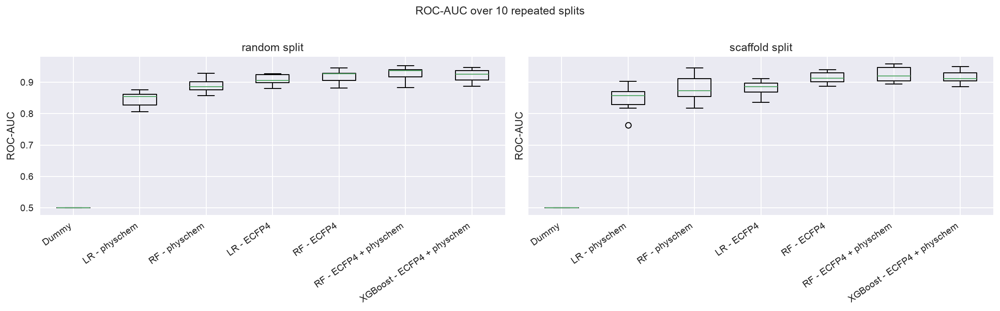
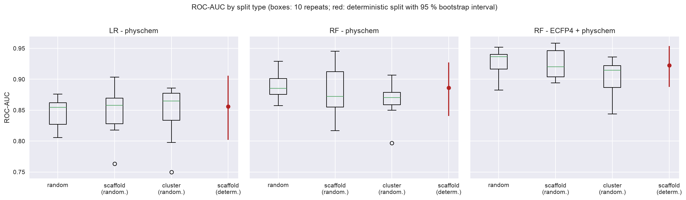
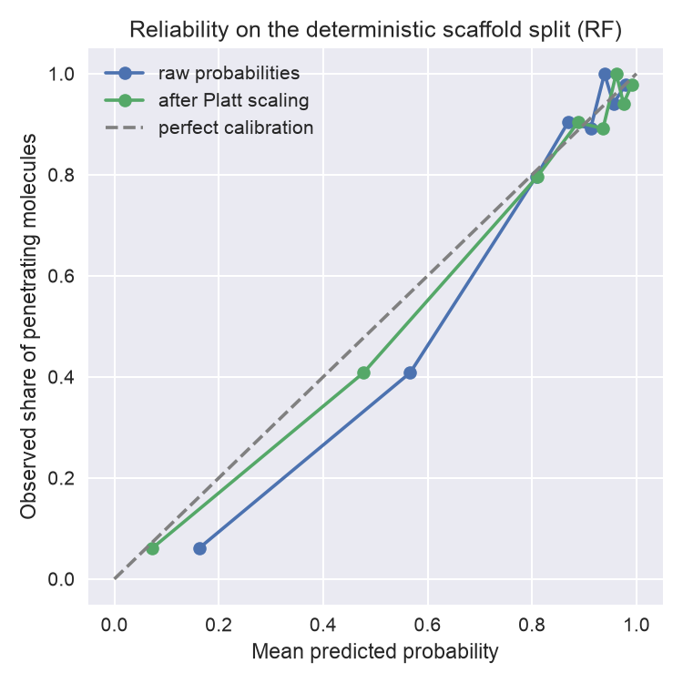
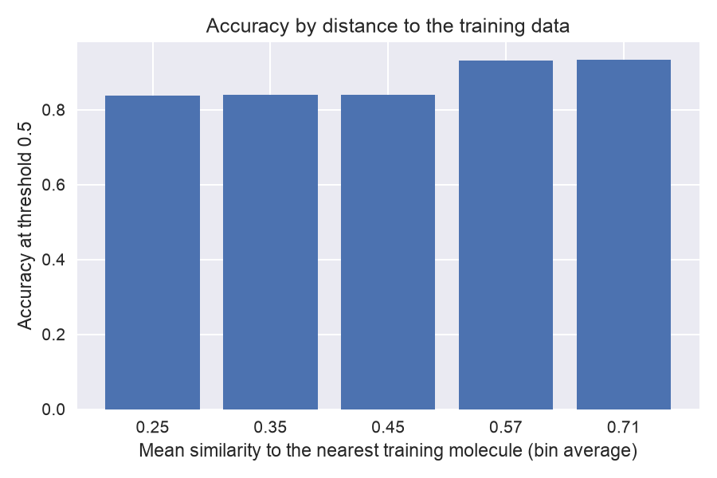

# Blood-Brain Barrier Permeability Prediction (BBBP)

Classification of small molecules as blood-brain barrier **penetrating** or **non-penetrating** on the BBBP dataset
(MoleculeNet), using classical machine learning on physicochemical descriptors and molecular fingerprints.

The focus is not the highest score but what the numbers mean: how the choice of split, the uncertainty across splits,
the decision threshold and the quality of the labels change the conclusions.

> Educational project. Not suitable for drug-design or safety decisions.

## Key findings

- **A random forest on ECFP4 fingerprints plus descriptors is the strongest and most robust model.** ROC-AUC is
  0.924 ± 0.023 (randomised scaffold split), 0.905 (cluster split) and 0.922 [0.887, 0.954] (deterministic scaffold
  split). It beats a logistic regression on seven descriptors by +0.057 to +0.081 ROC-AUC, in 9 to 10 of 10 repeats on
  every randomised split type.
- **One polarity descriptor is already strong.** TPSA alone separates the classes with an AUC of about 0.83 (hydrogen-bond
  donors 0.81). A descriptor baseline is therefore a necessary reference.
- **Harder splits barely lower ROC-AUC.** The cluster split places test molecules much farther from the training set
  (mean nearest-neighbour Tanimoto similarity 0.39 vs 0.56 for a random split), yet ROC-AUC falls only by 0.023
  (spread across repeats about 0.04).
- **Reliability depends on the distance to the training data.** Accuracy is about 0.84 for molecules whose nearest
  training molecule has a similarity below about 0.5, and 0.93 above it. ROC-AUC is 0.84 below a similarity of about 0.4,
  0.91 between 0.4 and 0.5, and 0.97 above 0.5.
- **Tuning gave no gain, the decision threshold did.** Nested tuning changed the outer test ROC-AUC by between -0.012
  and +0.005. A threshold chosen on training data only (0.76 to 0.81 instead of 0.5) raised balanced accuracy in all
  four outer splits (by 0.04 to 0.15), and Platt scaling lowered the Brier score in all four.
- **The labels are noisy.** 20 rows in groups of duplicates with conflicting labels were removed, and 10 of the 15 most
  confident false negatives are beta-lactam antibiotics labelled penetrating, although their nearest training
  neighbours appear to carry the opposite label. Part of the remaining error is probably not model error.

## Data and protocol

- **Dataset:** BBBP from MoleculeNet, 2,050 molecules with SMILES and a binary label (`p_np`), downloaded from the DeepChem
  data server.
- **Cleaning (notebook 01):** 11 invalid SMILES removed; duplicates found on canonical SMILES; 20 rows in groups with
  conflicting labels removed (the true label is unknown); 54 consistent duplicate rows merged. Result: 1,965 molecules.
- **Standardisation (notebook 02):** reduction to the largest fragment (105 molecules changed), then a second duplicate
  check (2 conflicting rows and 8 duplicate rows removed). Result: **1,955 molecules, 76.5 % penetrating**, so a model
  that always predicts "penetrating" reaches an accuracy of 0.765. Charges are not neutralised.
- **Features:** seven physicochemical descriptors (molecular weight, logP, TPSA, hydrogen-bond donors and acceptors,
  rotatable bonds, heavy atoms), ECFP4 fingerprint (radius 2, 2048 bits), and both combined.
- **Splits (80 % train, 20 % test, about 391 test molecules):**

| Split | Description | Repeats |
| :- | :- | :- |
| Random | Stratified random split | 10 |
| Scaffold (randomised) | Whole Murcko-scaffold groups go to the test set in random order while they fit the 20 % budget | 10 |
| Cluster (randomised) | Same procedure with Butina clusters (ECFP4 Tanimoto distance, cut-off 0.6) | 10 |
| Scaffold (deterministic) | Largest scaffold groups to training, rarest to test; ties between equal-sized groups broken by a fixed random order | 1 |

  Group-based splits are checked for leakage (no group on both sides).
- **Uncertainty:** mean and standard deviation over the repeated splits; for the single deterministic split, a bootstrap
  over test molecules (1000 resamples). Model comparisons are paired within a split.
- **Metrics:** ROC-AUC (main), PR-AUC and balanced accuracy. PR-AUC is compressed by the 77 % positive rate (dummy 0.77,
  best model 0.97) and separates models poorly.

## Pipeline

| Notebook | Content |
| :- | :- |
| `01_data_audit.ipynb` | Label balance, invalid SMILES, duplicates and label conflicts, descriptors by class, scaffold structure |
| `02_splits_and_baselines.ipynb` | Standardisation, features, random vs scaffold split (10 repeats), seven baseline models, nearest-neighbour similarity |
| `03_tuning_and_error_analysis.ipynb` | Harder splits (cluster, deterministic scaffold), nested group-aware tuning, threshold and calibration, error analysis |

## Results

### Data audit (notebook 01)

- 1,965 cleaned molecules, 1,020 scaffolds. 76 % of the scaffolds contain a single molecule, the ten largest groups hold
  22 % of the molecules, and 4.8 % of the molecules have no ring system.
- Several larger scaffold groups are almost pure (steroids 96 % penetrating, benzodiazepine core 100 %, phenothiazines
  100 %, barbiturates 100 %), while one group of 17 molecules is only 29 % penetrating.
- Single-descriptor ROC-AUC, oriented so that values above 0.5 mean good separation (higher TPSA, donors, acceptors,
  weight, size and flexibility go with non-penetrating molecules, higher logP with penetrating ones):

| Descriptor | TPSA | H-bond donors | H-bond acceptors | Molecular weight | Heavy atoms | Rotatable bonds | logP |
| :- | :- | :- | :- | :- | :- | :- | :- |
| AUC | 0.83 | 0.81 | 0.78 | 0.71 | 0.69 | 0.65 | 0.70 |

### Baselines on random and randomised scaffold splits (notebook 02)

ROC-AUC (mean ± standard deviation over 10 repeats):

| Model | Random | Scaffold (randomised) | Scaffold: difference to descriptor LR (better in) | Balanced accuracy (scaffold, threshold 0.5) |
| :- | :- | :- | :- | :- |
| Dummy | 0.500 | 0.500 | – | 0.500 |
| Logistic regression, descriptors | 0.847 ± 0.023 | 0.849 ± 0.041 | – | 0.772 |
| Random forest, descriptors | 0.889 ± 0.022 | 0.882 ± 0.040 | +0.032 (9 of 10) | 0.788 |
| Logistic regression, ECFP4 | 0.909 ± 0.015 | 0.883 ± 0.023 | +0.033 (9 of 10) | 0.785 |
| Random forest, ECFP4 | 0.918 ± 0.020 | 0.915 ± 0.019 | +0.065 (10 of 10) | 0.774 |
| Random forest, ECFP4 + descriptors | 0.928 ± 0.021 | 0.924 ± 0.023 | +0.075 (10 of 10) | 0.812 |
| XGBoost, ECFP4 + descriptors | 0.922 ± 0.020 | 0.916 ± 0.022 | +0.066 (10 of 10) | 0.823 |

The random split overstates ROC-AUC by -0.003 to +0.026 per model, which is inside the spread across repeats, although
test molecules are clearly less similar to the training set under the scaffold split (0.479 vs 0.560).



### Harder splits (notebook 03)

ROC-AUC of three default models; the deterministic split shows a 95 % bootstrap interval over test molecules:

| Split | Similarity to training | Logistic regression, descriptors | Random forest, descriptors | Random forest, ECFP4 + descriptors |
| :- | :- | :- | :- | :- |
| Random | 0.560 | 0.847 | 0.889 | 0.928 |
| Scaffold (randomised) | 0.479 | 0.849 | 0.882 | 0.924 |
| Cluster (randomised) | 0.391 | 0.847 | 0.866 | 0.905 |
| Scaffold (deterministic) | 0.462 | 0.856 [0.802, 0.906] | 0.886 [0.841, 0.927] | 0.922 [0.887, 0.954] |

The difference between random and cluster split is 0.023 for the random forest models (standard deviation of the per-repeat
difference 0.04) and -0.001 for the descriptor logistic regression. The random forest on ECFP4 + descriptors beats the descriptor logistic regression by
+0.081 (random), +0.075 (scaffold) and +0.057 (cluster), and the descriptor random forest by about +0.04 on all three.

The deterministic scaffold split is not directly comparable with published numbers. A study on J-STAGE reports about 0.73
ROC-AUC on the original MoleculeNet scaffold split of BBBP
(https://www.jstage.jst.go.jp/article/jccjie/9/0/9_2023-0017/_html). Because most scaffold groups are singletons, the
test set of a deterministic scaffold split depends on how ties between equal-sized groups are ordered; here a fixed random
order is used. This explanation was not tested.



### Nested tuning, threshold and calibration (notebook 03)

Outer test sets: the deterministic scaffold split and three randomised cluster splits. Inner tuning uses 5-fold
`GroupKFold` on the training part only (small grids for random forest and XGBoost); threshold and Platt scaling are fitted
on the out-of-fold predictions of the selected model.

| Outer split | Selected | Tuned minus default (RF) | Balanced accuracy at 0.5 | Balanced accuracy at chosen threshold | Brier raw | Brier calibrated |
| :- | :- | :- | :- | :- | :- | :- |
| Scaffold (deterministic) | RF | -0.012 | 0.793 | 0.841 (threshold 0.76) | 0.091 | 0.085 |
| Cluster #0 | RF | -0.004 | 0.710 | 0.862 (threshold 0.77) | 0.102 | 0.088 |
| Cluster #1 | RF | +0.005 | 0.786 | 0.822 (threshold 0.77) | 0.110 | 0.108 |
| Cluster #2 | RF | +0.004 | 0.776 | 0.841 (threshold 0.81) | 0.102 | 0.093 |

The random forest won the inner selection in all four outer splits, mostly with settings close to the defaults.
ROC-AUC is unchanged by calibration. The chosen threshold depends on the objective (here balanced accuracy) and has to be
set again for an application with different costs of errors.



### Error analysis (notebook 03)

Every molecule is predicted by a model that never saw its scaffold family (untuned random forest, 5-fold `GroupKFold` on
scaffolds). Overall accuracy at threshold 0.5 is 0.876, with 182 false positives and 60 false negatives: the model is too
liberal for the non-penetrating class, which matches the shifted optimal threshold.

By scaffold family:

| Family | Molecules | Penetrating | Accuracy | False positives |
| :- | :- | :- | :- | :- |
| Benzene only | 128 | 0.72 | 0.73 | 30 |
| Steroid | 74 | 0.96 | 0.96 | 3 |
| Benzodiazepine core | 26 | 1.00 | 1.00 | 0 |
| Steroid variant | 24 | 0.67 | 0.67 | 8 |
| Phenothiazine | 22 | 1.00 | 1.00 | 0 |
| Piperazine amide series | 17 | 0.29 | 0.29 | 12 |

Near-pure families are predicted well even without their relatives in the training set; errors concentrate in families
with mixed labels. Over the 24 families with at least 8 molecules accuracy is 0.870, in all other molecules 0.879.

By distance to the training data (five equally sized bins of the nearest-neighbour similarity):

| Mean similarity | Molecules | Accuracy | ROC-AUC |
| :- | :- | :- | :- |
| 0.25 | 393 | 0.837 | 0.841 |
| 0.35 | 389 | 0.841 | 0.839 |
| 0.45 | 391 | 0.839 | 0.908 |
| 0.57 | 392 | 0.931 | 0.965 |
| 0.71 | 390 | 0.933 | 0.967 |



Most confident errors (`results/03_confident_errors.csv`): ten of the 15 most confident false negatives are beta-lactam
antibiotics labelled penetrating, with a very low predicted probability although their similarity to training molecules
is mostly 0.56 to 0.71, which suggests that their neighbours carry the opposite label. Several of the most confident
false positives are drugs with known central effects (for example thiopental), which suggests label noise as well;
others (a permanently charged quaternary ammonium compound with low similarity to the training data, domperidone)
point to transport mechanisms that descriptors and fingerprints cannot represent. The labels were not re-checked
against primary sources.

### What can be trusted

| Statement | Evidence |
| :- | :- |
| The ECFP4 + descriptor random forest is better than the descriptor logistic regression | +0.057 to +0.081 ROC-AUC on all splits, better in 9 to 10 of 10 repeats |
| Split type has little influence on ROC-AUC | Differences up to 0.026, inside the spread across repeats |
| Performance falls for molecules far from the training set | ROC-AUC 0.84 below a similarity of about 0.4, 0.91 between 0.4 and 0.5, 0.97 above 0.5 |
| The default threshold 0.5 is not optimal | Balanced accuracy gain in 4 of 4 outer splits (0.04 to 0.15) |
| Hyperparameter tuning gave no reliable gain | -0.012 to +0.005 ROC-AUC on the outer test sets |
| A large share of the apparent errors may be label problems | Beta-lactam pattern, conflicting duplicates (not verified at the source) |

## Limitations

- One dataset with known label noise; the labels were not verified against primary sources.
- No external validation on a second blood-brain-barrier dataset.
- Test sets contain about 391 molecules. Repeated splits share molecules, so the spread across repeats is a guide and not
  an independent confidence interval.
- The deterministic scaffold split depends on how ties are ordered and is not comparable with published scaffold-split numbers.
- The cluster split depends on the Butina cut-off (0.6), a judgement call.
- Tuning grids are small, and only a few outer splits (one deterministic, three clustered) were used.
- The threshold maximises balanced accuracy only; calibration and threshold are fitted on out-of-fold predictions of
  models trained on 80 % of the training part and applied to a model trained on all of it.
- Standardisation keeps the largest fragment only and does not neutralise charges.
- The error analysis uses an untuned model and one grouping (scaffolds).

## Reproduce

```bash
git clone https://github.com/niclasgrafrosenberger/bbbp-permeability-prediction.git
cd bbbp-permeability-prediction

conda env create -f environment.yml
conda activate bbbp-env
python -m ipykernel install --user --name bbbp-env --display-name "Python (bbbp-env)"

python -c "import urllib.request; urllib.request.urlretrieve('https://deepchemdata.s3-us-west-1.amazonaws.com/datasets/BBBP.csv', 'data/raw/BBBP.csv')"

jupyter lab   # run notebooks 01 to 03 in order, kernel: Python (bbbp-env)
```

Run time: notebook 01 takes seconds, notebook 02 a few minutes, notebook 03 roughly 15 to 30 minutes (the nested tuning is
the slowest part; `N_OUTER_CLUSTER` controls its length). Data in `data/raw` and `data/processed` are not tracked in
Git. Notebook 01 writes `data/processed/bbbp_clean.csv`, notebook 02 writes `data/processed/bbbp_standardised.csv`, and
all notebooks write tables to `results/` and figures to `results/figures/`.

## Repository structure

```
notebooks/     01 data audit, 02 splits and baselines, 03 tuning and error analysis
data/          raw/ and processed/ (not tracked)
results/       metric tables (csv) and figures/
environment.yml
```

## Possible next steps

- External validation on a larger blood-brain-barrier dataset
- A graph neural network under the same harder splits, as an exploratory comparison
- A review of the most confident errors against primary sources
- An applicability-domain flag based on the similarity to the training set
- A threshold chosen for a concrete use case, with explicit costs for false positives and false negatives

## References

- Martins IF, Teixeira AL, Pinheiro L, Falcao AO. A Bayesian approach to in silico blood-brain barrier penetration modeling.
  *J Chem Inf Model* 2012;52(6):1686-1697.
- Wu Z et al. MoleculeNet: a benchmark for molecular machine learning. *Chem Sci* 2018;9:513-530.
- Rogers D, Hahn M. Extended-connectivity fingerprints. *J Chem Inf Model* 2010;50(5):742-754.
- Bemis GW, Murcko MA. The properties of known drugs. 1. Molecular frameworks. *J Med Chem* 1996;39(15):2887-2893.
- Butina D. Unsupervised data base clustering based on Daylight's fingerprint and Tanimoto similarity. *J Chem Inf Comput Sci*
  1999;39(4):747-750.
- RDKit: open-source cheminformatics, https://www.rdkit.org

## License

MIT, see `LICENSE`.
